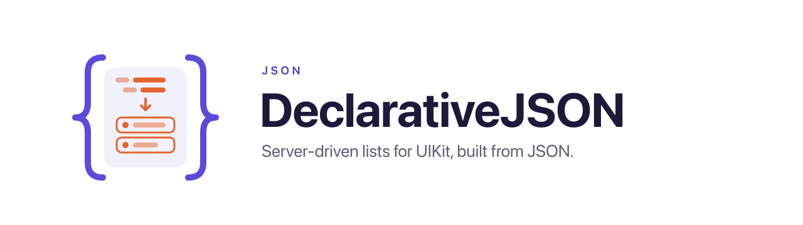
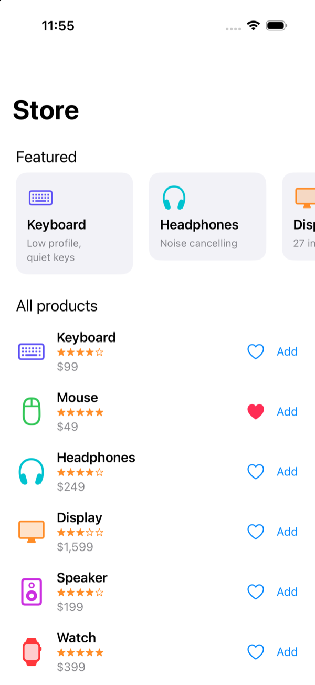
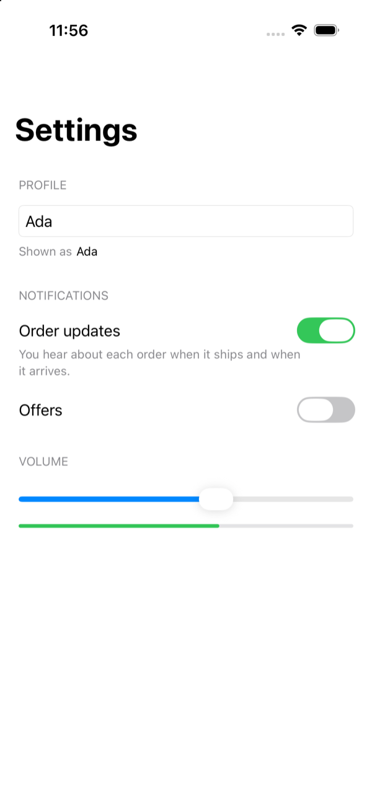

<p align="center">
  <picture>
    <source media="(prefers-color-scheme: dark)" srcset="docs/images/declarative-json-dark.svg">
    
  </picture>
</p>

# DeclarativeJSON

[English](README.md) | [简体中文](README.zh-Hans.md) | **繁體中文**

UIKit 的伺服端驅動列表。一份 JSON 文件寫明 cell 的範本、項目和點擊後做什麼；函式庫用 [DeclarativeUIKit](https://github.com/nothingsh/DeclarativeUIKit) 的 stack 搭出 cell，用 [DeclarativeCombine](https://github.com/nothingsh/DeclarativeCombine) 繫結，再放進 collection view 顯示。

```json
{
  "v": 1,
  "templates": {
    "product": {
      "type": "hstack", "spacing": 12, "alignment": "center", "padding": 16,
      "children": [
        { "type": "image", "url": "$image", "width": 56, "height": 56, "cornerRadius": 8, "clipsToBounds": true },
        { "type": "vstack", "alignment": "leading", "spacing": 4, "children": [
          { "type": "label", "text": "$title", "font": "headline" },
          { "type": "label", "text": "$subtitle", "font": "footnote", "textColor": "secondaryLabel", "numberOfLines": 2 }
        ]},
        { "type": "spacer" },
        { "type": "button", "title": "$price", "onTap": { "action": "navigate", "url": "$detailURL" } }
      ]
    }
  },
  "sections": [
    { "id": "today", "layout": "list", "items": [
      { "id": "p1", "template": "product", "data": { "title": "Keyboard", "subtitle": "Low profile", "price": "$99", "image": "https://…", "detailURL": "app://product/1" } }
    ]}
  ]
}
```

```swift
let document = try DocumentDecoder().decode(data)

var actions = ActionRegistry.standard
actions.register(.navigate) { context in
    if let url = context.url("url") { router.open(url) }
}

let controller = DocumentViewController(document: document, actions: actions)
controller.onIssue = { print($0) }
```

以 `$` 開頭的值引用項目 `data` 裡的一個鍵，其餘都是常數。動作在 App 本機執行：`navigate` 和 `openURL` 把 URL 交給你註冊的閉包，`set` 和 `toggle` 在裝置上修改項目的資料，你也可以註冊自己的動作和元件。清單（manifest）列出全部元件、屬性和動作，給產生文件的後端使用。

## 目錄

- [需求](#需求)
- [安裝](#安裝)
- [文件](#文件)
- [引用](#引用)
- [元件](#元件)
- [版面配置](#版面配置)
- [取值](#取值)
- [事件與動作](#事件與動作)
- [頁面](#頁面)
- [自訂元件](#自訂元件)
- [主題](#主題)
- [圖片](#圖片)
- [文件裡的問題](#文件裡的問題)
- [版本](#版本)
- [清單](#清單)
- [範例 App](#範例-app)

## 需求

- iOS 15+
- Swift 5.9+

## 安裝

Swift Package Manager。在 `Package.swift` 裡：

```swift
dependencies: [
    .package(url: "https://github.com/nothingsh/DeclarativeJSON.git", .upToNextMinor(from: "0.6.0"))
]
```

1.0 之前，0.7.0 這類次版本可能有破壞性變更（見 [CHANGELOG](CHANGELOG.md)），所以這裡只接受 0.6 的修訂版本。DeclarativeUIKit 和 DeclarativeCombine 會一併引入。

## 文件

文件有三個鍵：

- `v`，格式的版本。這一版讀取第 1 版；其他版本的文件解碼失敗，丟出 `DocumentError.unsupportedVersion`。後來的版本在第 1 版上新增了什麼，見[版本](#版本)。
- `templates`，從名稱對應到 cell 或 header 的視圖樹。
- `sections`，依序排列。section 有 `id`、`layout`、可選的 `header`、它的 `items`，還有[後續項目](#載入更多)時有 `more`。

```json
{ "id": "featured", "layout": "carousel",
  "header": { "template": "title", "data": { "text": "Featured" } },
  "items": [ { "id": "f1", "template": "card", "data": { "name": "Keyboard" } } ] }
```

`layout` 取 `list`，一欄佔滿寬度、高度隨內容的 cell；取 `carousel`，一列橫向捲動；或取 `grid`，每列若干等寬的 cell。預設是 `list`。`grid` 另有 `columns`（每列幾個 cell，預設 2）和 `spacing`（cell 之間的橫向與縱向間距，預設 0）。一列的高度取這一列裡最高的 cell，每個 cell 保持自己的高度，靠這一列的頂端。項目有在整頁唯一的 `id`、所用 `template` 的名稱、它的 `data`（一個 JSON 物件），以及可選的 [`tracking`](#曝光)。header 同樣有 `template` 和 `data`。

範本裡的節點是一個物件，帶 `type`、它的屬性，stack 還帶 `children`，還可以帶 [`fallback`](#版本)：

```json
{ "type": "vstack", "spacing": 4, "children": [
  { "type": "label", "text": "$title", "font": "headline" }
]}
```

## 引用

屬性值是以 `$` 開頭的字串時，取項目資料裡該鍵的值：`"text": "$title"`。引用就是整個值，不串接、不運算、不做條件判斷，所以格式化好的文字、價格和 URL 由後端放進 `data`，拿來就能顯示。`$$` 表示錢字號：`"$$5 off"` 是文字 `$5 off`。`data` 裡的字串永遠不是引用。

引用的鍵不存在或為 `null`，或值的型別不對，該屬性視為未設定，視圖顯示預設值。型別不對還會回報。

沒有 `not`，所以可見性有兩個屬性。共用一個引用的兩個視圖，一個寫 `isHidden`，一個寫 `isVisible`：

```json
{ "type": "button", "image": "heart", "isHidden": "$liked", "onTap": { "action": "toggle", "path": "liked" } },
{ "type": "button", "image": "heart.fill", "isVisible": "$liked", "onTap": { "action": "toggle", "path": "liked" } }
```

請傳送 `false`，不要省略這個鍵：值缺少時兩個視圖都會顯示。

## 元件

屬性名稱就是設定它的 DeclarativeUIKit modifier 的名稱。帶標籤參數的 modifier 取以這些標籤為鍵的物件，例如 `"border": { "color": "separator", "width": 1 }`。

| 型別 | 屬性 | 事件 |
| --- | --- | --- |
| `vstack` | `alignment`（`leading`、`center`、`trailing`、`fill`）、`spacing`、`highlight` | `onTap` |
| `hstack` | `alignment`（`top`、`center`、`bottom`、`firstTextBaseline`、`lastTextBaseline`、`fill`）、`spacing`、`highlight` | `onTap` |
| `vscroll`、`hscroll` | 與 `vstack`、`hstack` 相同的 `alignment` 和 `spacing`，另有 `showsIndicators`、`bounces` | |
| `spacer` | `minLength`，只接受常數 | |
| `label` | `text`、`markdown`、`font`、`textColor`、`numberOfLines`、`textAlignment`、`lineHeight`、`adjustsFontSizeToFitWidth` | |
| `image` | `url`、`image`、`contentMode`（`scaleToFill`、`scaleAspectFit`、`scaleAspectFill`、`center`） | |
| `button` | `title`、`titleColor`、`image`、`isEnabled` | `onTap` |
| `textfield` | `text`、`placeholder`、`font`、`textColor`、`textAlignment`、`keyboardType`、`returnKeyType`、`isSecureTextEntry`、`isEnabled` | `onChange`、`onReturn` |
| `switch` | `isOn`、`onTintColor`、`isEnabled` | `onChange` |
| `slider` | `value`、`minimumValue`、`maximumValue`、`minimumTrackTintColor`、`maximumTrackTintColor`、`isEnabled` | `onChange` |
| `progress` | `progress`、`progressTintColor`、`trackTintColor` | |
| `activity` | `isAnimating`、`hidesWhenStopped`、`color` | |

每個元件還接受 `width`、`height`、`aspectRatio`、`padding`、`background`、`cornerRadius`、`clipsToBounds`、`border`、`alpha`、`tintColor`、`overlay`、`isHidden`、`isVisible`、`layoutPriority`、`accessibilityLabel` 和 `accessibilityIdentifier`。

- `image` 與 `button` 的 `image` 是[主題](#主題)裡的圖片名稱，主題裡沒有時在 App 的 asset catalog 裡找，再找不到時當作 SF Symbol。`image` 同時有 `url` 時，它一直顯示到 URL 的圖片載入完成。
- 不是 stack 也不是捲動視圖的視圖設了 `padding`，會被放進一個帶該內距的 stack。除了輔助使用屬性，其餘通用屬性都作用在這個 stack 上，所以背景會蓋住內距。
- 設了 `onTap` 的 `vstack` 或 `hstack`，點擊其中任何位置都會執行它的動作，因此可以點擊整列；按住時 stack 會顯示醒目提示，`"highlight": false` 關閉醒目提示。其中的控制項，如按鈕或開關，仍處理自己的點擊，也不讓 stack 顯示醒目提示。給這個 stack 設定 `accessibilityLabel`，VoiceOver 會把它讀成一個按鈕。
- `overlay` 在視圖前面放一個節點，或一組節點，後面的在上層。每個是 `{ "alignment": ..., "offset": { "x": ..., "y": ... }, "content": 節點 }`。`alignment` 取 `fill`（預設）、`center`、`top`、`bottom`、`leading`、`trailing`、`topLeading`、`topTrailing`、`bottomLeading` 或 `bottomTrailing`。`offset` 移動內容，x 朝 trailing 邊、y 朝下；`fill` 不接受 `offset`。尺寸由視圖決定，`clipsToBounds` 也會裁掉疊放內容。`content` 裡的引用讀取項目資料。除非疊放裡有節點設了事件，觸控會穿過它交給後面的視圖。`overlay` 只接受常數。
  ```json
  { "type": "image", "url": "$cover", "width": 120, "height": 120,
    "overlay": { "alignment": "topTrailing", "offset": { "x": -6, "y": 6 },
                 "content": { "type": "label", "text": "$badge", "font": "caption2", "padding": 4,
                              "background": "systemRed", "textColor": "white", "cornerRadius": 4 } } }
  ```
- `repeat` 放在 `vstack`、`hstack`、`vscroll` 或 `hscroll` 裡，依 `items`（陣列或指向陣列的引用）的每個元素，把 `template` 複製一份放進容器的子節點之間，所以各份跟著容器的間距與對齊：
  ```json
  { "type": "hstack", "spacing": 4, "children": [
    { "type": "label", "text": "Tags:" },
    { "type": "repeat", "items": "$tags",
      "template": { "type": "label", "text": "$value", "padding": 4, "background": "secondarySystemFill", "cornerRadius": 4 } }
  ]}
  ```
  項目資料裡有 `"tags": ["New", "Free shipping"]` 時顯示兩個標籤，陣列變了就顯示相應的個數。範本裡的 `$` 引用讀元素而不是項目：元素是物件時讀它的鍵，其他元素用 `$value`。範本需要的項目資料，請放進元素裡。範本裡的動作照常執行，參數從元素讀取，但 `set` 與 `toggle` 不能修改元素，會被移除。`repeat` 只接受 `items` 和常數 `template`；0.6.0 之前的版本改為顯示它的 `fallback`。
- `label` 的 `markdown` 用行內 Markdown 取代 `text` 顯示：`**粗體**`、`*斜體*`、`~~刪除線~~` 和 `` `程式碼` ``，用 label 自己的字型與顏色。連結和圖片只顯示文字，不能點；標題、清單等區塊語法和換行照原樣顯示。為 0.6.0 之前的版本保留純文字的 `text`，它們會忽略 `markdown`：
  ```json
  { "type": "label", "text": "Now ¥99, was ¥129", "markdown": "**Now ¥99** ~~¥129~~" }
  ```
- `label` 的 `lineHeight` 設定每行的高度，文字在行內垂直置中。它和字型一樣隨系統字級縮放。
- `textfield` 有圓角邊框。`label` 與 `textfield` 會跟著動態字級調整。

## 版面配置

stack 依序排列子節點，間隔 `spacing`：

- 多出的空間由會伸展的子節點平分：`spacer`，沒寫 `width` 的 `textfield`、`slider`、`progress`，以及含有它們的 stack。沒有這樣的子節點時，空間留在最後一個子節點之後；要把空間放在別處，例如末端的箭頭之前，就在那裡放一個 `spacer`。
- 空間不夠時，先把 spacer 壓到 `minLength`，再依 `layoutPriority`（預設 0）壓縮其他子節點：低的先壓縮，相同時靠前的先壓縮。標題在價格前面時標題先被壓縮、價格保持完整；要讓標題完整，就給它更高的 `layoutPriority`。寫了 `width` 或 `height` 的子節點維持該尺寸。

```json
{ "type": "hstack", "spacing": 8, "children": [
  { "type": "label", "text": "$title" },
  { "type": "spacer" },
  { "type": "label", "text": "$price", "layoutPriority": 1 }
]}
```

`layoutPriority` 只接受常數。0.7.0 之前的版本會忽略它，並且在有多餘空間又沒有 spacer 時拉伸第一個能拉伸的子節點。

## 取值

- **顏色**：[主題](#主題)裡的顏色名稱，預設就是系統顏色名稱，如 `label`、`secondaryLabel`、`systemBackground`、`separator`、`systemBlue`；`#RRGGBB` 或 `#RRGGBBAA`；或 `{ "light": "#000000", "dark": "#FFFFFF" }`。邊框顏色只讀取一次，之後在淺色與深色模式間切換時不會跟著變。
- **字型**：主題裡的字型名稱，預設就是 text style，即 `largeTitle`、`title1` 到 `title3`、`headline`、`subheadline`、`body`、`callout`、`footnote`、`caption1` 或 `caption2`；或 `{ "size": 15, "weight": "semibold" }`，字重從 `ultraLight` 到 `black`。這個字級是預設文字大小下的字級，會隨使用者設定的文字大小放大縮小，與內文相同。
- **內距**（`padding`）：一個數字表示四邊相同，或一個物件，含 `top`、`leading`、`bottom`、`trailing`、`horizontal`、`vertical` 中任意幾個。單邊優先於所在的軸，沒寫的邊為 0。
- **長度**，如 `width` 和 `minLength`，必須是有限且非負的數；`aspectRatio` 必須大於 0。

## 事件與動作

`onTap`、`onChange` 和 `onReturn` 接受一個動作，或依序執行的動作陣列：

```json
"onTap": [
  { "action": "toggle", "path": "liked" },
  { "action": "track", "event": "like", "liked": "$liked" }
]
```

參數可以是引用，在動作執行時才讀取，所以上面第二個動作看到的是第一個動作改過的資料。

| 動作 | 參數 | 作用 |
| --- | --- | --- |
| `navigate` | `url` | 把 URL 交給你註冊的閉包，例如你的 router。 |
| `openURL` | `url` | 把 URL 交給你註冊的閉包，例如 `UIApplication.shared.open`。 |
| `set` | `path`、`value` | 把項目資料中 `path` 處設為 `value`。 |
| `toggle` | `path` | 反轉 `path` 處的 Bool；不存在時變成 `true`。 |

註冊之前，`navigate` 和 `openURL` 什麼也不做，並回報這一點。`path` 是項目資料的鍵，只能寫常數。

`onChange` 帶一個值：`textfield` 的文字、`switch` 的開關狀態、`slider` 的值。不寫 `value` 的 `set` 儲存這個值，讓資料與控制項保持一致：

```json
{ "type": "switch", "isOn": "$enabled", "onChange": { "action": "set", "path": "enabled" } }
```

不會傳送任何東西給伺服器。要傳送，或做別的事，就註冊一個動作：

```swift
var actions = ActionRegistry.standard
actions.register(ActionSpec("track", parameters: ["event": PropertySpec(.string), "liked": PropertySpec(.bool)])) { context in
    analytics.track(context.string("event"), liked: context.bool("liked"))
}
```

`ActionContext` 用 `string`、`url`、`bool` 和 `number` 讀取參數，型別不對時會回報；`parameters` 給出全部參數。`event` 是事件的值，`data` 是項目的資料，`update { $0["key"] = … }` 像 `set` 一樣修改資料。

`item` 說明動作是為哪個項目執行的：它的 `id`、`section`、`template` 和 `tracking`；section 的 header 則 `isHeader` 為 true、沒有 `id`。`sourceView` 是發出事件的視圖，`page` 是 `DocumentViewController`，用來從它們彈出畫面：

```swift
actions.register(ActionSpec("share", parameters: ["url": PropertySpec(.url)])) { context in
    guard let url = context.url("url"), let page = context.page else { return }
    let sheet = UIActivityViewController(activityItems: [url], applicationActivities: nil)
    sheet.popoverPresentationController?.sourceView = context.sourceView
    page.present(sheet, animated: true)
}
```

動作可以等待，例如等一個請求。用了 `await` 或 `try` 的處理閉包是非同步的：拋出錯誤即失敗。非同步動作接受 `onSuccess` 與 `onFailure`，值是一個動作或動作陣列，在處理閉包回傳或拋出錯誤時執行；陣列裡排在它後面的動作，等它和它的 `onSuccess` 或 `onFailure` 執行完才執行。先改資料，請求失敗再改回來：

```json
"onTap": [
  { "action": "toggle", "path": "liked" },
  { "action": "like", "id": "$id", "onFailure": { "action": "toggle", "path": "liked" } }
]
```

```swift
actions.register(ActionSpec("like", parameters: ["id": PropertySpec(.string)])) { context in
    // 拋出錯誤時執行 onFailure。
    let count = try await api.like(context.string("id"))
    context.update { $0["likes"] = .number(Double(count)) }
}
```

`update` 在處理閉包等待期間和回傳之後都可以呼叫。修改仍會套用到觸發動作的那個項目，即使它的 cell 此時已經在顯示別的項目；修改作用在項目當時的資料上，等待之後執行的動作讀的也是這份資料。頁面裡已經沒有這個項目時（例如 `setDocument` 之後），什麼都不會改，這些動作也不會執行。頁面釋放時，處理閉包的任務會被取消。

其他動作把 `onSuccess` 與 `onFailure` 當作未知屬性回報，0.4.0 之前的版本也是如此。manifest 用 `async` 標出非同步動作。

## 頁面

`DocumentViewController` 在 collection view 裡顯示文件。頁面是 collection view 的 delegate 和 data source；`collectionView` 的其餘部分可以由你設定，例如內容的 inset。要收到捲動回呼，設定 `scrollViewDelegate`。

每個 cell 第一次顯示時依範本建出視圖並保留；顯示另一個項目時只把該項目的資料送給繫結。`set` 和 `toggle` 修改的是頁面持有的項目資料，所以 cell 捲出再捲回時改動仍在，cell 也會依新內容調整高度。

```swift
controller.setDocument(newDocument)
```

`setDocument` 顯示更新後的文件。section 與項目依 `id` 對應並帶動畫，新文件的資料取代裝置上做過的改動。

只改頁面的一部分時（例如某個項目的價格變了），套用一個 patch：

```json
{ "v": 1,
  "templates": { "notice": { "type": "label", "text": "$text", "padding": 12 } },
  "operations": [
    { "op": "replaceItems", "items": [ { "id": "p1", "template": "product", "data": { "title": "Keyboard", "price": "89.00" } } ] },
    { "op": "insertItems", "section": "today", "after": "p1", "items": [ { "id": "n1", "template": "notice", "data": { "text": "Back in stock" } } ] },
    { "op": "removeItems", "ids": ["p3"] }
  ] }
```

```swift
let patch = try DocumentDecoder().decodePatch(data)
controller.apply(patch)
```

`replaceItems` 和 `replaceSections` 原地取代 `id` 相同的項目和 section。`insertItems` 把項目插到 `section` 裡項目 `after` 的後面，`insertSections` 把 section 插到 section `after` 的後面；沒寫 `after` 時插在最前面。`removeItems` 和 `removeSections` 刪除 `ids` 裡的項目和 section，section 連同它的項目一起刪除。`templates` 可省略：加入新範本，取代同名的範本，用到它的 cell 會重建。

操作依序執行，頁面一起做動畫。被取代或新插入的項目和 section 顯示 patch 的資料；其餘項目保留裝置上做過的改動，這一點和 `setDocument` 不同。patch 引用了頁面沒有的 `id`，或插入頁面已有的 `id` 時，略過那個項目、section 或操作，其餘照常套用。函式庫本身不發請求：patch 來自你自己的請求，或來自非同步動作裡收到的回應，用 `context.page?.apply(patch)` 套用。0.4.0 之前的版本不能套用 patch。

### 載入更多

section 的項目比文件裡帶的多時，用 `more` 表示，值是後端傳送後續項目需要的任何東西，例如游標。函式庫不讀它，原樣交回：

```json
{ "id": "feed", "more": { "cursor": "c2" }, "items": [ … ] }
```

使用者捲到離這種 section 結尾不到五個項目時，頁面呼叫 `onLoadMore`，傳入 section 的 `id` 和它的 `more`。載入後續項目，用 patch 附加，同時帶上再往後的 `more`；到底了就不寫 `more`：

```json
{ "v": 1, "operations": [ { "op": "appendItems", "section": "feed", "items": [ … ], "more": { "cursor": "c3" } } ] }
```

```swift
controller.onLoadMore = { [weak controller] section, more in
    Task {
        do {
            let data = try await api.nextPage(section: section, after: more)
            controller?.apply(try DocumentDecoder().decodePatch(data))
        } catch {
            controller?.showLoadMoreFailure(in: section)
        }
    }
}
```

在此之前，list 或 grid 的 section 在項目下方顯示轉圈，頁面也不再為這個 section 發起載入。呼叫 `showLoadMoreFailure(in:)` 後改為顯示重試按鈕，捲回 section 結尾也會重試。carousel 兩者都不顯示，捲到接近結尾時發起載入。附加、取代或插入這個 section 的 patch，以及 `setDocument`，結束載入。

轉圈和重試按鈕（VoiceOver 標籤是英文）是預設視圖。要顯示你自己的視圖，例如在地化的文字，把 `makeLoadMoreView` 設為建立一個遵循 `LoadMoreView` 的 `UIView`：頁面呼叫它的 `showLoading()`，以及 `showFailure(retry:)` 並傳入一個閉包，供你的按鈕呼叫。它用 Auto Layout 決定自己的大小，頁面會把它重複用在其他 section。

```swift
controller.makeLoadMoreView = { MyLoadMoreView() }
```

0.5.0 之前的版本忽略 `more`，略過 `appendItems`。

### 載入中、失敗與更新

不帶文件建立的頁面顯示 `loadingView`，直到 `setDocument`。`showLoading()` 再次用它取代 section 顯示；`showFailure(retry:)` 顯示 `failureView`，其中的按鈕呼叫 `retry()`：它重新顯示 `loadingView` 並呼叫你的閉包。`setDocument` 和 `apply` 重新顯示 section。頁面沒有項目、也沒有帶 `more` 的 section 時，顯示 `emptyView`。

設定 `onRefresh` 會加上下拉更新控制項。使用者下拉時頁面呼叫它，並傳入一個閉包，做完後呼叫：

```swift
let controller = DocumentViewController(actions: actions)   // 顯示 loadingView
func load() {
    Task {
        do {
            controller.setDocument(try DocumentDecoder().decode(try await api.page()))
        } catch {
            controller.showFailure { load() }
        }
    }
}
load()

controller.onRefresh = { done in
    Task {
        if let data = try? await api.page(), let document = try? DocumentDecoder().decode(data) {
            controller.setDocument(document)
        }
        done()
    }
}
```

這些視圖顯示在 section 後面、填滿 collection view，所以空頁面或失敗的頁面也能下拉。預設的視圖是轉圈和英文提示；把 `loadingView`、`failureView`、`emptyView` 換成你自己的，例如頁面的骨架畫面或在地化的文字，你的失敗視圖要呼叫 `retry()`。下拉更新失敗時不需要 `showFailure`：呼叫 `done`，頁面保留目前顯示的內容。

### 曝光

項目可以帶 `tracking`，值是你的埋點統計需要的任何東西，例如廣告 id；函式庫不讀它，原樣交給你：

```json
{ "id": "p1", "template": "product", "data": { … }, "tracking": { "slot": 3, "campaign": "fall" } }
```

```swift
controller.onImpression = { item in
    analytics.impression(item.tracking)
}
```

使用者看到一個帶 `tracking` 的項目時，頁面呼叫一次 `onImpression`：頁面在 window 裡、且所在 scene 不在背景時，項目至少一半在螢幕上、連續半秒；進入背景會讓計時重新開始。要換標準，設定 `impressionFraction` 和 `impressionDuration`。同一份文件裡每個項目只回報一次；`setDocument` 之後重新計算，取代項目的 patch 不會讓它再回報一次。動作也能在 `context.item` 裡讀到 `tracking`，可以用你自己的動作統計點擊。0.6.0 之前的版本忽略 `tracking`。

## 自訂元件

註冊一個型別，寫明它接受什麼、怎麼建出視圖：

```swift
var components = ComponentRegistry<UIView>.standard
components.register(ComponentSpec("rating", properties: ["value": PropertySpec(.number)])) { context in
    RatingView().onValue(context.number("value")) { view, value in
        view.rating = value ?? 0
    }
}
let controller = DocumentViewController(document: document, components: components, actions: actions)
```

`BuildContext` 把每個屬性讀成 publisher，節點沒設定該屬性時回傳 nil。常數送出一次；引用隨項目資料的每個值送出。`number`、`length`、`integer`、`bool`、`string`、`url`、`color`、`font`、`image` 和 `insets` 依頁面的 `theme` 讀取上文的各種型別，`choice` 讀取一組字串之一，`value` 讀取其他任何東西。`onValue` 把屬性套用到視圖，`onEvent` 在視圖的某個 publisher 上執行 `context.action(.onTap)`，並把這個視圖當作動作的 `sourceView`。要自己執行動作，就用事件的值和視圖呼叫 `context.action` 回傳的值：`action(.bool(isOn), source: view)`。spec 寫了 `acceptsChildren: true` 時，子節點已替你建好，放在 `context.children`。通用屬性會作用在你回傳的視圖上。

註冊已有的型別會取代它。`repeat` 不是元件，不能註冊：這個型別的節點一律是 [`repeat`](#元件)。

## 主題

文件裡的顏色名稱、字型名稱和圖片名稱都來自頁面的 `Theme`。`Theme.standard` 以 UIKit 的名稱提供系統顏色與 text style，沒有圖片。替換一個名稱，所有用到它的文件都隨之改變；也可以加上自己的名稱：

```swift
var theme = Theme.standard
theme.colors["brand.primary"] = UIColor(named: "BrandPrimary")
theme.colors["secondaryLabel"] = UIColor(named: "Subtitle")
theme.fonts["price"] = .custom(.systemFont(ofSize: 20, weight: .bold))
theme.fonts["headline"] = .custom(UIFont(name: "Avenir-Heavy", size: 17)!, relativeTo: .headline)
theme.images["heart.fill"] = UIImage(systemName: "heart.fill")
let controller = DocumentViewController(document: document, theme: theme)
```

主題裡的字型跟隨動態字體：`.textStyle(_:)` 與該 text style 相同；`.custom(_:relativeTo:)` 從給定字級出發，依給定的 text style 的比例放大縮小，預設是 body。顏色可以是動態顏色，跟隨淺色與深色模式。

主題裡沒有的圖片名稱會依序在 asset catalog 和 SF Symbols 裡找；都找不到時回報 `unknownImage`，不顯示圖片。其他平台也要顯示的文件應只用主題裡的名稱，由各平台的 App 各自註冊。

## 圖片

`image` 的 `url` 由 `ImageLoader.urlSession` 載入，圖片快取在記憶體裡。要用自己的圖片載入方案：

```swift
let loader = ImageLoader { url, completion in
    let request = imagePipeline.load(url) { image in completion(image) }
    return AnyCancellable { request.cancel() }
}
let components = ComponentRegistry<UIView>.standard(imageLoader: loader)
```

URL 改變時，視圖取消先前的載入並忽略它的結果。

## 文件裡的問題

只有在不是 JSON、版本不同，或骨架寫錯時，文件才會解碼失敗。骨架指 `v`、`templates`、`sections`、每個 section 和項目的 `id`，以及每個項目和 header 的 `template`。其餘問題都盡量顯示，並回報給 `onIssue`，每份文件同一問題只報一次：

- 未知的元件型別顯示為節點的 `fallback`，沒有時顯示為空的視圖；
- 未知的屬性或事件，以及在只接受常數處寫的引用，會被忽略；
- 型別不對的值視為缺少；
- 不是帶 `type` 的物件的節點、未知或寫錯的動作、重複的 `id`、範本不存在的項目或 header 會被移除；
- 未知的 `layout` 以列表顯示；
- stack 之外的 `repeat`，以及 `repeat` 裡的 `set` 與 `toggle`，會被移除；
- 找不到的圖片名稱不顯示圖片；
- patch 裡未知的操作、頁面沒有的 `id`，以及插入處頁面已有的 `id`，會被略過。

每個 `Issue` 都寫明位置，例如 `templates.product.children[2]`；patch 的問題寫 patch 裡的位置，例如 `operations[1].items[0]`。patch 的問題每次套用都會回報。

## 版本

App 停在建置時的版本，所以後端寫的文件也要讓舊版本讀得懂。格式第 1 版只做增量，一個版本遇到不認得的內容會回報並略過。`DocumentVersion.minor` 表示一個版本讀得懂哪些新增：

| `minor` | 函式庫版本 | 新增 |
| --- | --- | --- |
| 0 | 0.1.0 | 第 1 版 |
| 1 | 0.2.0 | `vstack` 和 `hstack` 的 `onTap`；`fallback` |
| 2 | 0.3.0 | `overlay`；`grid` 版面；`vstack` 與 `hstack` 的 `highlight` |
| 3 | 0.4.0 | 非同步動作的 `onSuccess` 與 `onFailure`；patch |
| 4 | 0.5.0 | section 的 `more`；`appendItems`；顏色 `systemMint`、`systemCyan`、`systemBrown` |
| 5 | 0.6.0 | 項目的 `tracking`；`label` 的 `markdown` 與 `lineHeight`；`repeat` |
| 6 | 0.7.0 | `layoutPriority`；[版面配置規則](#版面配置) |

請求時帶上它，後端就只寫 App 讀得懂的內容：

```swift
request.setValue("\(DocumentVersion.current).\(DocumentVersion.minor)", forHTTPHeaderField: "Document-Version")
```

節點還可以帶一個 `fallback`：App 不認得這個節點的型別時（例如後來的版本才加的元件），改為顯示它。`fallback` 本身也可以再帶 `fallback`。0.2.0 之前的版本不讀 `fallback`。

```json
{ "type": "rating", "value": "$score", "fallback": { "type": "label", "text": "$scoreText" } }
```

## 清單

[`manifest.json`](manifest.json) 列出內建元件及其屬性、每個屬性的型別和是否接受引用、所有元件共有的屬性，以及內建動作、它們的參數和是否非同步，patch 的操作、`repeat` 的屬性、標準主題的顏色名稱、字型名稱和圖片名稱，還有它描述的版本 `v` 與 `minor`。後端的程式碼產生器可以讀取它，檢查自己寫出的文件。加上你自己的元件、動作和主題：

```swift
let manifest = try Manifest(components: components, actions: actions, theme: theme).encoded()
```

[`protocol/`](protocol/README.md) 用不依賴 iOS 的說法描述格式本身，寫給後端和其他平台的渲染器，並附有每個渲染器都要跑的[共用案例](protocol/cases/README.md)。

## 範例 App

`Example/Example.xcodeproj` 是一個以本機 package 方式使用本函式庫的 iOS App。用 Xcode 開啟，在 iOS 模擬器上執行 `Example` scheme。每個畫面，包括選單，都是 `Example/Example/Documents` 裡的一份 JSON 文件；`navigate` 到 `example://store` 會開啟 `store.json`。`Pages.swift` 註冊了 router、`openURL`、`addToCart` 與 `showProduct` 兩個動作和一個 `rating` 元件。Feed 畫面模擬從伺服器載入、延遲一秒：顯示載入中與失敗視圖，從 `more` 指名的 patch `feed-2.json`、`feed-3.json` 載入後續頁，下拉時重新載入。

 

## 授權

MIT，見 [LICENSE](LICENSE)。
